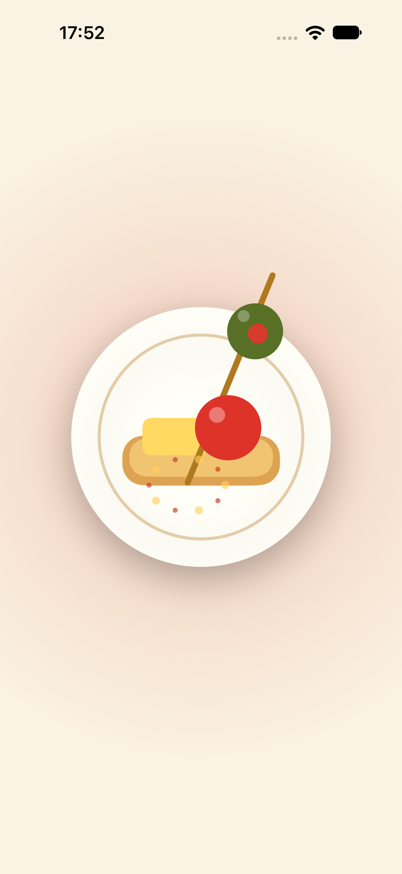
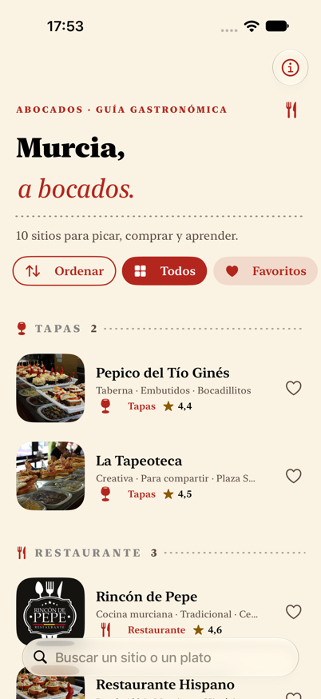
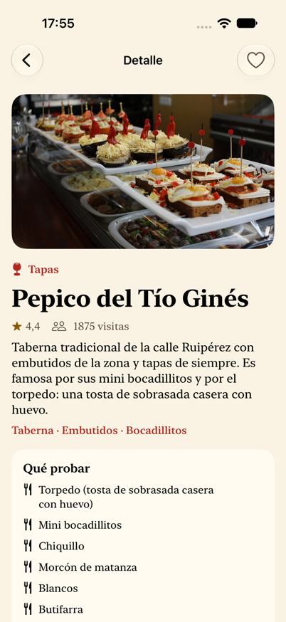
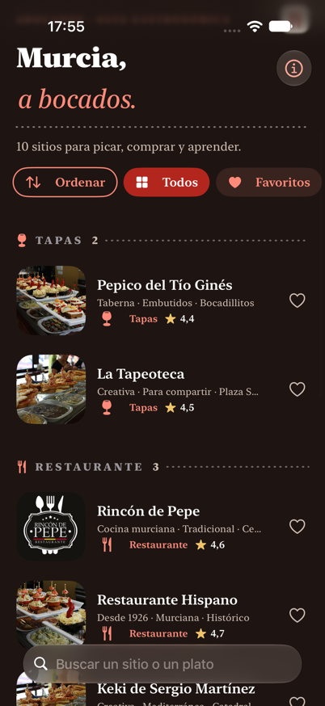
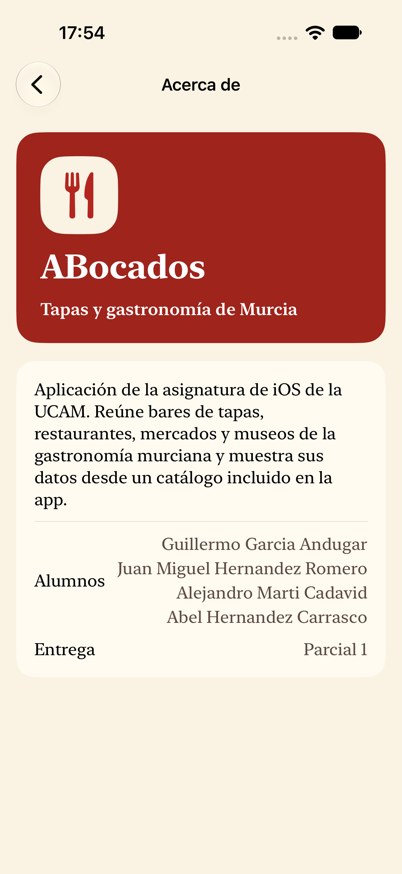
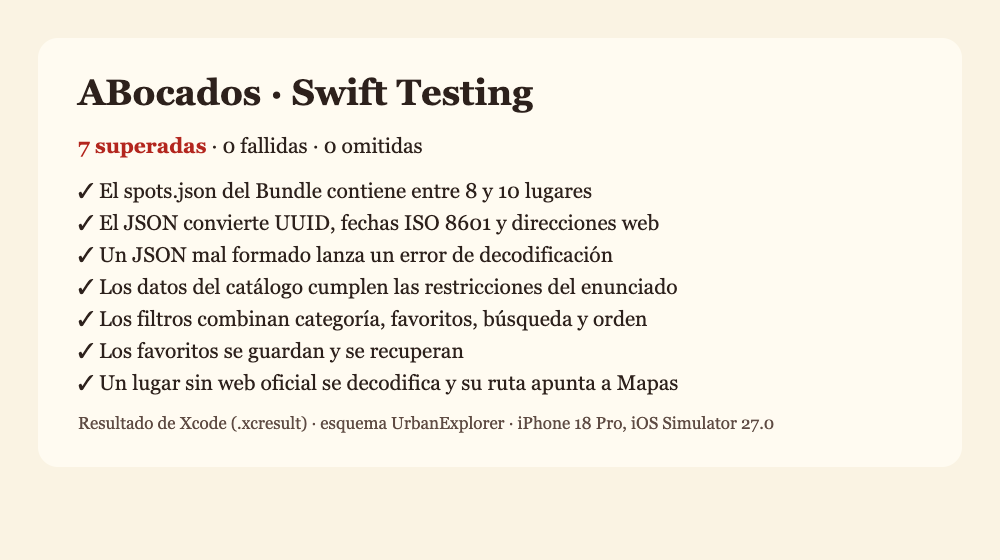

# ABocados

Guía de tapas y gastronomía de Murcia · Programación de Aplicaciones iOS (UCAM) · Entregable parcial 1

**Alumnos:** Guillermo Garcia Andugar, Juan Miguel Hernandez Romero, Alejandro Marti Cadavid y Abel Hernandez Carrasco.

ABocados reúne bares de tapas, restaurantes, mercados, pastelerías y museos de la gastronomía murciana. Los datos se leen de `spots.json`, incluido en el Bundle, y se muestran en una lista agrupada por categorías con filtros, búsqueda y favoritos.

## Cómo ejecutar

Xcode 26 · iOS 17 o posterior · abrir `UrbanExplorer.xcodeproj`, elegir el esquema **UrbanExplorer** y un simulador de iPhone, y pulsar ⌘R.

El proyecto y el módulo se llaman `UrbanExplorer`; el nombre visible de la app es **ABocados**.

## Funcionalidades

- **Intro animada:** se monta un pincho mientras se descargan las fotos. Se puede saltar tocando la pantalla y respeta «Reducir movimiento».
- **Lista** agrupada por categoría (Tapas, Restaurante, Mercado, Dulces, Museo) con foto, título, etiquetas, categoría y valoración.
- **Filtros** por categoría y favoritos, y orden por destacados, valoración, visitas o nombre.
- **Búsqueda** por nombre, etiqueta o plato (por ejemplo «torpedo» o «pastel de carne»).
- **Favoritos** guardados en `UserDefaults`.
- **Detalle** con descripción, platos, fecha, coordenadas, opiniones, botón **Cómo llegar** (Apple Maps) y web oficial si existe.
- **Acerca de** desde el botón `i` o el logotipo de la cabecera.
- Modo claro y oscuro: los colores están definidos en `Assets.xcassets` con variante para cada modo.

## Estructura

```
UrbanExplorer/
├── UrbanExplorerApp.swift
├── Model/       Spot, Review, SpotFilter
├── Services/    JSONLoader, FavoritesStore, ImageStore
├── Views/       SpotListView, SpotRowView, SpotDetailView, AboutDetailView, FilterBarView,
│                FavoriteButton, SpotImageView, LaunchAnimationView, BottomUpReveal, ExplorerLogo
└── Resources/   spots.json, Assets.xcassets (iconos, placeholder y colores)
UrbanExplorerTests/JSONLoaderTests.swift
```

## Datos

`spots.json` contiene 10 lugares reales con todos los campos del enunciado. Las coordenadas se comprobaron en OpenStreetMap y las webs son las oficiales. `webURL` es opcional: Pastelería Bonache no tiene web verificable, así que no se muestra el botón. El campo opcional `dishes` recoge platos típicos cuando constan en las fuentes.

Las valoraciones, visitas y opiniones son datos de ejemplo.

## Pruebas

Número de pruebas: **7** (Product ▸ Test, ⌘U). Usan Swift Testing y no necesitan red.

| Prueba | Qué comprueba |
| --- | --- |
| `cargaDelBundle` | `spots.json` se decodifica y tiene entre 8 y 10 lugares con UUID únicos. |
| `decodificaTiposNativos` | Fecha ISO 8601, UUID, URL y opinión anidada. |
| `rechazaJSONMalFormado` | Un JSON mal formado lanza `DecodingError`. |
| `datosDelCatalogoValidos` | Valoraciones, puntos y coordenadas en rango, y al menos una imagen por lugar. |
| `filtrosDeLaLista` | Filtro por categoría y favoritos, búsqueda por nombre y plato, y orden por valoración. |
| `favoritosPersistentes` | Un favorito se recupera al crear de nuevo el almacén. |
| `lugarSinWebYConRuta` | Un lugar sin `webURL` se decodifica y su ruta apunta a Mapas. |

Escritas antes de pedir código a la IA: `cargaDelBundle`, `decodificaTiposNativos` y `rechazaJSONMalFormado`. El resto se añadió junto a cada funcionalidad.

## Capturas

| Intro | Lista | Detalle |
| --- | --- | --- |
|  |  |  |

| Modo oscuro | Acerca de |
| --- | --- |
|  |  |

Pruebas superadas:



## Uso de IA

Se usó el asistente de IA de Xcode como apoyo para el código, las pruebas y la documentación. Los lugares, webs y coordenadas se verificaron a mano en Turismo de Murcia, OpenStreetMap y las webs oficiales. Todo el código se ha revisado y el equipo puede explicarlo.

## Créditos de las fotografías

Las fotos se descargan desde Wikimedia Commons y, en dos casos, desde la web oficial del lugar. Las de **Pepico del Tío Ginés**, **La Tapeoteca**, **Restaurante Hispano** y **Keki** son fotos ilustrativas de tapas de Murcia, no del propio local. La de **Rincón de Pepe** es su logotipo.

| Lugar | Fotografía | Licencia |
| --- | --- | --- |
| Mercado de Verónicas | [Sebasgs](https://commons.wikimedia.org/wiki/File:Mercado_de_Ver%C3%B3nicas.JPG) | CC BY 3.0 |
| Pepico, La Tapeoteca, Hispano y Keki | [Grey World](https://commons.wikimedia.org/wiki/File:Bar_tapas_in_Murcia_-_6305308713.jpg) | CC BY 2.0 |
| Museo Etnológico de la Huerta | [Marinaserranourjc](https://commons.wikimedia.org/wiki/File:MUSEO_ETNOL%C3%93GICO_DE_LA_HUERTA.jpg) | CC0 |
| Pastelería Bonache | [Zarateman](https://commons.wikimedia.org/wiki/File:Murcia_-_Plaza_de_las_Flores_4.jpg) | CC0 |
| Mercado de Santa Florentina | [Zarateman](https://commons.wikimedia.org/wiki/File:Cartagena_-_Mercado_de_Santa_Florentina_2.jpg) | CC0 |
| Rincón de Pepe y Museo del Vino de Bullas | Webs oficiales de cada lugar | — |
